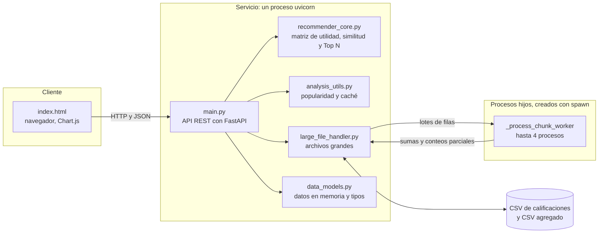
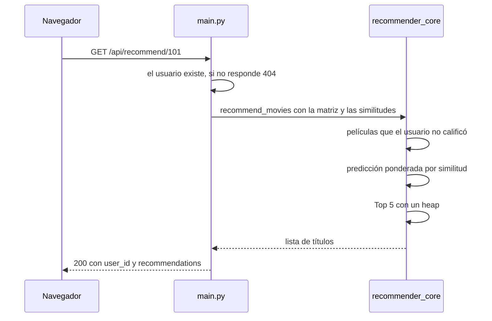

# Arquitectura

## Diagrama de componentes

| Componente | Responsabilidad | Detalle |
|---|---|---|
| `index.html` | Interfaz web. Consume la API en `http://localhost:8000/api`. | [Funcional](funcional.md) |
| `main.py` | Define los endpoints, valida las entradas y arma las respuestas. Orquesta a los demás módulos y tiene poca lógica propia. | [API](api.md) |
| `recommender_core.py` | Matriz de utilidad, similitud coseno vectorizada y recomendación Top N. | [Diseño técnico](diseno-tecnico.md) |
| `analysis_utils.py` | Ranking de popularidad con caché e invalidación. | [Diseño técnico](diseno-tecnico.md) |
| `large_file_handler.py` | Generación, lectura por lotes y procesamiento paralelo de CSV grandes. | [Diseño técnico](diseno-tecnico.md) |
| `data_models.py` | Datos de demostración y los tipos (`Movie`, `User`, `Rating`, `PopularMovie`). | [Referencia](referencia.md) |

Las dependencias van en un solo sentido: `main.py` conoce a los demás módulos, y ninguno conoce a `main.py`. Los
módulos de negocio dependen de `data_models.py` solo para los **tipos**.

## Flujo de una recomendación

## Ciclo de vida

1. **Arranque.** Al importar `main.py` se construyen, una sola vez, la matriz de utilidad (`prepare_data`) y la
   matriz de similitudes (`calculate_similarity`). Con los datos de demostración, el cálculo tarda una fracción de segundo.
2. **Peticiones.** Los endpoints son funciones `def`: FastAPI las ejecuta en su pool de hilos. Las recomendaciones solo
   **leen** la matriz compartida, así que no hay condiciones de carrera.
3. **Escrituras.** `POST /api/rate` agrega una calificación a la lista cruda e invalida el caché de popularidad. No
   toca la matriz de similitudes.
4. **Archivos grandes.** El endpoint de la demostración usa procesos (no hilos): es trabajo de CPU, y con hilos el GIL
   impediría el paralelismo real.

## Modelo de concurrencia

| Qué | Con qué | Por qué |
|---|---|---|
| Atender peticiones en paralelo | Hilos (pool de FastAPI) | Las lecturas comparten la matriz sin copiarla. Con procesos habría que replicar los datos en cada uno (en la versión Eficiente eran 230 MB por proceso). |
| Procesar un archivo grande | Procesos (`ProcessPoolExecutor`, contexto `spawn`) | Es CPU puro. Cada proceso recibe solo su lote, no hay que replicar ninguna matriz grande. |

El contexto `spawn` se usa en todas las plataformas: crear procesos con `fork()` desde un proceso con hilos (el pool de
FastAPI) puede dejarlos trabados, y Python 3.14 deja de usarlo por defecto en Linux.

## Tecnologías

| Pieza | Versión | Para qué |
|---|---|---|
| Python | 3.11 o superior (probado con 3.11, 3.12 y 3.13) | Lenguaje |
| FastAPI | 0.162.0 | API REST y validación con Pydantic 2.14 |
| Uvicorn | 0.54.0 | Servidor ASGI |
| NumPy | 2.4.6 en Python 3.11 y 2.5.4 en 3.12 o superior | Álgebra lineal vectorizada |

Las versiones exactas, con sus hashes, están en `requirements.txt` y `requirements-dev.txt` (ver
[Instalación](instalacion.md)).

## Qué cambiaría para escalar

Hoy el servicio es **una sola instancia con estado en memoria**. Para atender más tráfico habría que sacar ese
estado afuera: una base de datos para las calificaciones, un caché compartido para la popularidad y una matriz de
similitudes dispersa o calculada por lotes. Cada instancia nueva, tal como está, tendría su propia copia de los
datos y no vería las calificaciones que llegaron a otra.
