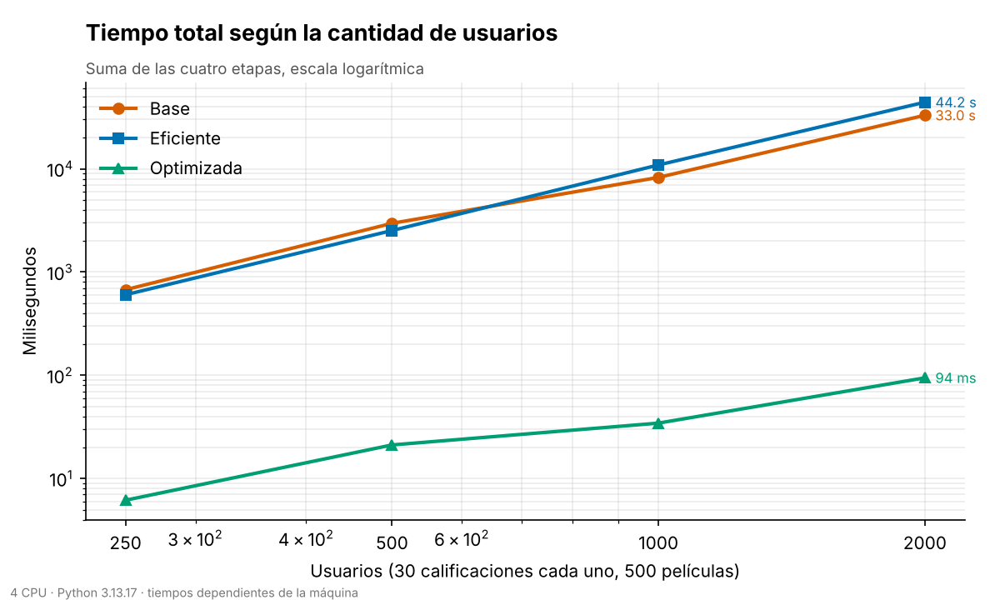
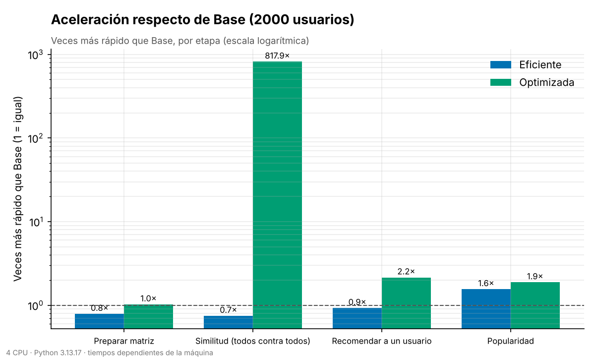
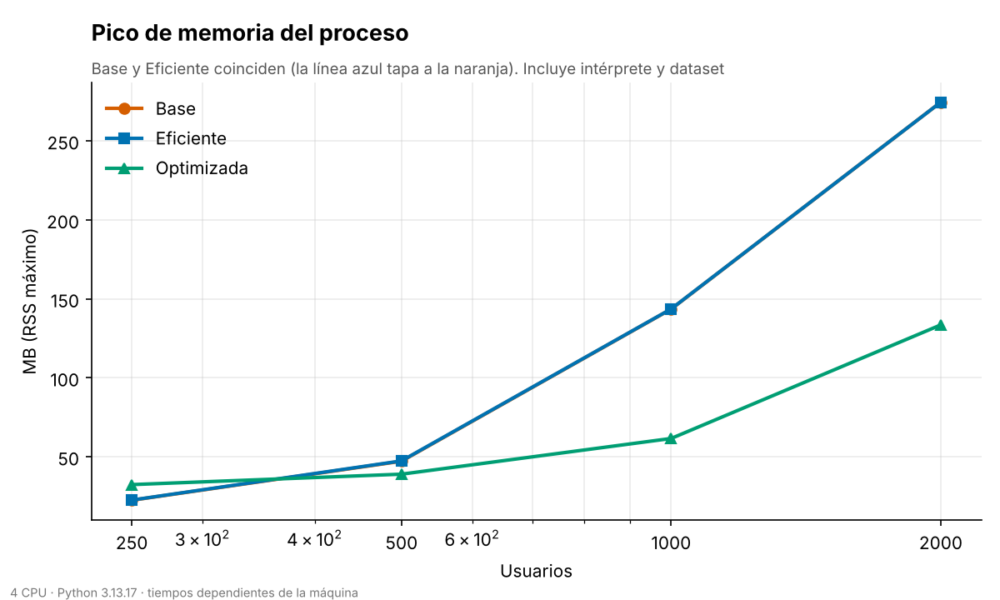
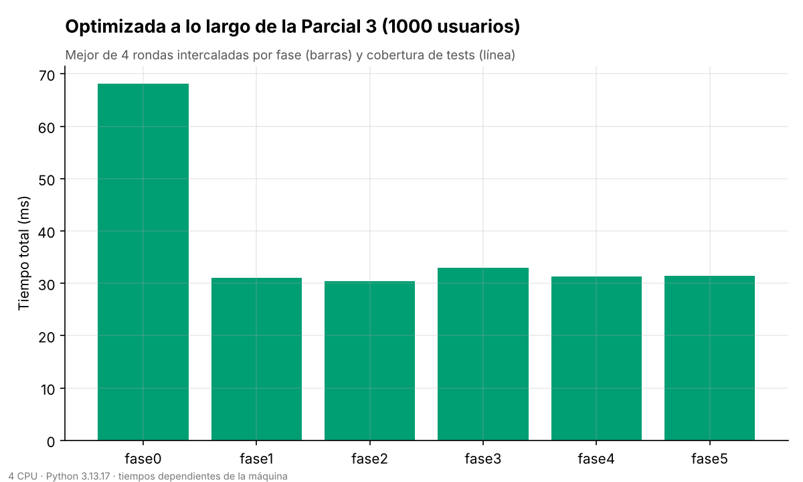

# Evolución entre versiones

Esta página responde una pregunta que el enunciado del Parcial 3 no hace pero el proyecto sí se debe: **¿cuánto
mejoró la eficiencia de una entrega a otra, y se mantuvo después?** Todas las cifras salen de
`Ver-Optimizada/metrics/evolucion.json`, que genera `python tasks.py evolucion`.

!!! warning "Cómo leer los números"
    Los tiempos dependen de la máquina (aquí: 4 CPU, Python 3.13.17, contenedor compartido). Sirven para
    **comparar las versiones entre sí**, no para compararlas con otro equipo. El ruido entre corridas seguidas del
    mismo código llegó a 1,7 veces, por eso el historial intercala rondas y se queda con la mejor.

## Cómo se mide

- **El mismo dataset para las tres versiones**: generador con semilla fija (42), 500 películas, 30 calificaciones
  por usuario. (Los `benchmark.py` de Base y Eficiente usan datos distintos en cada corrida.)
- **Un subproceso por (versión, tamaño)**: los tres directorios tienen módulos con el mismo nombre
  (`recommender_core`...) y no pueden convivir en un intérprete.
- **Cuatro etapas**: preparar la matriz, similitud de todos contra todos, recomendar a un usuario y popularidad.
- **Tamaños**: 250, 500, 1.000 y 2.000 usuarios. Tiempo: mediana de las repeticiones (1 en las versiones lentas con
  2.000 usuarios, porque Base tarda más de 30 s). Memoria: pico de RSS del proceso (`ru_maxrss`).
- **Control de equivalencia**: la medición falla si las tres versiones no recomiendan lo mismo con los mismos datos.

## Tiempo total



| Usuarios | Base | Eficiente | Optimizada |
|---:|---:|---:|---:|
| 250 | 674 ms | 603 ms | 6 ms |
| 500 | 2,97 s | 2,52 s | 21 ms |
| 1.000 | 8,26 s | 10,90 s | 34 ms |
| 2.000 | 33,0 s | 44,2 s | 94 ms |

- **Optimizada es unas 350 veces más rápida que Base con 2.000 usuarios** (33,0 s contra 94 ms).
- **La Eficiente no es más rápida que la Base en este banco: con 1.000 y 2.000 usuarios es más lenta** (0,75×).
  Armar dos `set` por cada par de usuarios cuesta más que recorrer 30 elementos con un `in` sobre un diccionario, y
  hay 4 millones de pares. Las mejoras del Parcial 1 (heap, diccionarios, caché) se notan en `analyze_popularity`
  (1,6×), no en la similitud, que domina el tiempo. El README informa una mejora de 231 s a 185 s para la Eficiente
  con otro dataset y sin semilla; no se reprodujo aquí. Con ruido de hasta 1,7× entre corridas, esa diferencia de
  20 % no es concluyente.
- **Crecimiento observado** (pendiente de log tiempo contra log usuarios): Base 1,83 y Eficiente 2,07, cerca de
  cuadrático (todos contra todos); Optimizada 1,25. Es una estimación con cuatro puntos, no una demostración.

## Aceleración por etapa



Casi toda la ganancia está en la similitud (**818×**): pasar de pares de diccionarios a una multiplicación de
matrices `float32` en BLAS. El resto de las etapas mejora poco (1× a 2,2×); por eso, tras la optimización, el cuello de
botella pasó a `recommend_movies` (ver [Rendimiento](rendimiento.md)).

## Memoria



Con 2.000 usuarios, Base y Eficiente llegan a 274,5 MB (el diccionario de similitudes, de n² entradas, domina) y
Optimizada a 133,5 MB. Con pocos usuarios Optimizada gasta **más** (32 MB contra 22 MB con 250): importar NumPy tiene
un costo fijo. La mejora aparece cuando el problema crece.

## Qué pasó durante el Parcial 3



Se midió el código de cada tag `parcial3-fase0` a `parcial3-fase5` con 1.000 usuarios (mejor de 4 rondas):

| Fase | Tiempo total | Tests | Cobertura |
|---|---:|---:|---:|
| 0 (punto de partida) | 68 ms | 11 | 70,7 % |
| 1 (refactor con tests de caracterización) | 31 ms | 24 | 100 % |
| 2 | 30 ms | 35 | 100 % |
| 3 | 33 ms | 47 | 100 % |
| 4 | 31 ms | 57 | 100 % |
| 5 | 31 ms | 81 | 100 % |

- La **única mejora de rendimiento** fue en la Fase 1 (`recommend_movies` bajó de 48 ms a 14 ms al refactorizar las
  funciones que Xenon rechazaba). Después, el núcleo no cambió: las Fases 2 a 5 agregaron CI, seguridad, documentación y
  tests **sin costo de rendimiento**, que es lo que el control de benchmarks del CI debe garantizar.
- Una primera pasada simple mostró fase 4 y 5 un 50 % más lentas. Era ruido: el código del núcleo es idéntico al de la
  fase 3, y alternando las corridas dieron lo mismo. De ahí el diseño de rondas intercaladas.

## Calidad del código por versión

| Versión | CC promedio | CC máxima | MI de `recommender_core` | Sentencias (núcleo) |
|---|---:|---:|---:|---:|
| Base | 7,00 | 13 | 52,7 | 83 |
| Eficiente | 4,83 | 9 | 62,2 | 74 |
| Optimizada | 3,45 | 5 | 67,6 | 111 |

La complejidad y la mantenibilidad mejoran en cada entrega, aunque el código de Optimizada es más largo (suma NumPy
y funciones auxiliares). Medido con Radon sobre `recommender_core.py` y `analysis_utils.py`.

## Limitaciones

- Una sola máquina y un solo dataset sintético (usuarios con 30 calificaciones, 500 películas).
- No se mide la API ni el procesamiento de archivos grandes, que solo existen en Optimizada.
- Las versiones Base y Eficiente se midieron una vez con 2.000 usuarios.
- Las mediciones **no corren en el CI** (Base y Eficiente tardan casi dos minutos entre las dos y los tiempos de los
  runners son inestables). Se rehacen a mano con `python tasks.py evolucion` y se confirman los gráficos antes de versionarlos.

## Reproducir

```bash
cd Ver-Optimizada
python tasks.py evolucion                    # mide todo y dibuja (unos 5 minutos)
python evolucion/medir.py graficar           # solo vuelve a dibujar a partir del JSON
```
